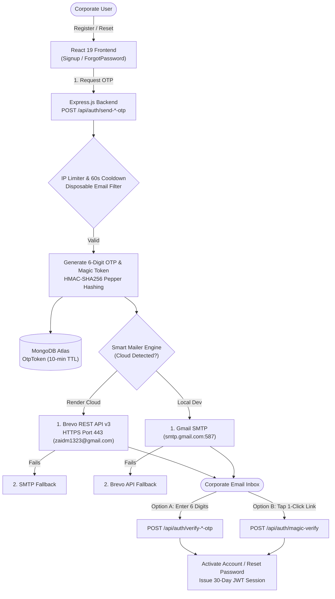

# Demo Infotech (InfinityHub) — Enterprise IT Hardware & Rental Platform

A production-ready, full-stack B2B Enterprise IT Hardware & Equipment Leasing Platform built on the MERN stack (MongoDB, Express.js, React 19, Node.js). Designed for corporate procurement, hardware leases, and refurbished commercial IT equipment.

---

## 🌐 Live Production Deployments

- **Frontend (Vercel):** [https://infinityhub-pro.vercel.app/](https://infinityhub-pro.vercel.app/)
- **Backend API (Render):** [https://infinityhub-u9yq.onrender.com/](https://infinityhub-u9yq.onrender.com/)
- **GitHub Repository:** [https://github.com/zaid154/infinityhub.git](https://github.com/zaid154/infinityhub.git)
- **API Health Check:** [https://infinityhub-u9yq.onrender.com/api/health](https://infinityhub-u9yq.onrender.com/api/health)

---

## 🚀 Quick Start (Local Run)

### 1. Start Express Backend
```bash
cd server
npm install
npm run dev
# Server runs on http://localhost:5001
# Connected to MongoDB Atlas (technova_hardware)
```

### 2. Start React Frontend
```bash
cd client
npm install
npm run dev
# Client runs on http://localhost:5173
```

---

## 🔑 Initial Admin Credentials

| Field | Value |
|---|---|
| **Portal Login** | `https://infinityhub-pro.vercel.app/login` |
| **Admin Dashboard** | `https://infinityhub-pro.vercel.app/admin` |
| **Email** | `zaidm1323@gmail.com` |
| **Password** | `Zaid@9999201255` |

*(Credentials and site branding can also be customized dynamically via Admin Settings)*

---

## 📧 Production 6-Digit OTP & 1-Click Magic Link Verification System

InfinityHub implements an enterprise-grade dual-channel verification engine supporting both **6-digit numeric OTP codes** and **1-Click Magic Links** for account activation and password resets across local development and cloud production.

### 1. Verification Architecture & User Flow



### 2. Frontend Security & UX Components
- **6-Digit Interactive OTP Card (`client/src/pages/Signup.jsx` & `ForgotPassword.jsx`)**:
  - 6 individual numeric input boxes with auto-advance, backspace navigation, and full-clipboard paste support.
  - **60-Second Live Cooldown Timer**: Prevents request spamming with real-time second-by-second countdown before re-enabling the resend button.
  - **1-Click Magic Link Notice**: Displays prominent advice that users can simply tap the 1-Click verification button in their email without typing digits.
- **Auto-Detecting Magic Link Verifier (`client/src/pages/VerifyEmail.jsx` & `ResetPassword.jsx`)**:
  - Reads `verify_email`/`verify_token` or `reset_email`/`reset_token` from query parameters.
  - Automatically triggers `POST /api/auth/magic-verify` on page load, authenticates the session, and redirects to the dashboard without manual intervention.

### 3. Vercel API Proxy Rewrites (`client/vercel.json` & `vercel.json`)
- In production (`https://infinityhub-pro.vercel.app`), requests to `/api/*` are reverse-proxied directly to the Render backend (`https://infinityhub-u9yq.onrender.com/api/*`), preventing CORS issues and preserving live headers.
- All client-side SPA routes fall back seamlessly to `/index.html`.

### 4. Cryptographic Storage & Brute-Force Defense (`server/middleware/securityMiddleware.js` & `server/models/OtpToken.js`)
- **No Plaintext Storage**: All OTPs and Magic Link tokens are hashed using HMAC-SHA256 with `OTP_SECRET` (pepper) before being persisted in MongoDB.
- **Sliding-Window IP Rate Limiting**: Restricts requests to 10 OTP dispatches per hour per IP address.
- **Per-Email 60s Cooldown**: Returns HTTP `429 Too Many Requests` if an OTP is requested again within 60 seconds (`lastSentAt`).
- **Disposable Email Filter**: Blocks 25+ temporary and throwaway email domains.
- **Brute-Force Lockout**: Invalidates the OTP code after **5 failed attempts**.
- **10-Minute Auto-Deletion**: MongoDB native TTL index (`expires: 600`) purges expired tokens automatically.
- **Telemetry Logging (`server/models/EmailLog.js`)**: Tracks channel (`brevo_api` vs `gmail_smtp`), latency in ms, message ID, and delivery status with 30-day TTL retention.

### 5. Dual-Channel Cloud Routing (`server/config/mailer.js`)
- **Cloud Production (Render)**: Detects `process.env.RENDER` and routes through **Brevo v3 HTTPS API (port 443)** first, avoiding Render's blocked outbound SMTP ports (`25`, `465`, `587`) and eliminating the 10-second SMTP socket hang.
- **Verified Sender Auto-Discovery**: Caches verified senders via Brevo `/v3/senders` API, ensuring all transactional dispatches originate from `zaidm1323@gmail.com`.
- **Local Development**: Uses standard Gmail SMTP first with seamless fallback to Brevo HTTPS API.

### 6. Authentication API Endpoints Reference

| Method | Endpoint | Purpose | Security Controls |
|---|---|---|---|
| `POST` | `/api/auth/send-register-otp` | Dispatches 6-digit OTP & Magic Link for registration | IP Rate Limit, Cooldown, Anti-bot Honeypot |
| `POST` | `/api/auth/verify-register-otp` | Validates 6-digit OTP and creates verified user | HMAC Pepper Check, Max 5 Attempts |
| `POST` | `/api/auth/send-reset-otp` | Dispatches 6-digit OTP & Magic Link for password reset | Generic Response (No user enumeration) |
| `POST` | `/api/auth/verify-reset-otp` | Validates OTP or Magic Token and updates password | Min 6 char password, HMAC check |
| `POST` | `/api/auth/magic-verify` | 1-Click instant email activation from email link | Single-use token, Immediate auto-deletion |

---

## 🔑 Required Email & Security Environment Variables

```env
# MongoDB & JWT Auth
MONGO_URI=mongodb+srv://...
JWT_SECRET=your_jwt_secret_key
OTP_SECRET=your_hmac_sha256_pepper_secret

# Brevo Transactional Email (HTTPS Port 443 - Primary on Render)
BREVO_API_KEY=your_brevo_api_key
BREVO_SENDER_EMAIL=zaidm1323@gmail.com
BREVO_SENDER_NAME="Demo Infotech"

# Gmail SMTP (Primary for Local Dev, Fallback on Cloud)
SMTP_HOST=smtp.gmail.com
SMTP_PORT=587
SMTP_SECURE=false
SMTP_USER=your_email@gmail.com
SMTP_PASS=your_gmail_app_password
SMTP_FROM="Demo Infotech <zaidm1323@gmail.com>"
CLIENT_URL=https://infinityhub-pro.vercel.app
```

---

## 🌟 Key Features & Integrations

### 1. Dynamic Site Settings (Zero Hardcoding)
Store details, contact phones, WhatsApp numbers, warehouse addresses, and bank details can be modified live through the **Admin Settings** (`/admin/settings`) tab without rebuilding or redeploying code.

### 2. Google Gemini AI Consultant & Content Generator
- **AI Hardware Advisor:** Floating chat widget on the frontend providing real-time recommendations for laptop specs, enterprise servers, and lease terms.
- **AI Product Description Generator:** One-click automated B2B marketing description generation within the Admin product creation form.

### 3. Cloudinary Multi-Image Media Management
- Multi-file image uploads streamed directly to Cloudinary folder `technova-hardware`.
- Optimized image transformations and CDN delivery.

### 4. Razorpay Payment Gateway (TEST Mode)
- Integrated online checkout for hardware orders with server-side HMAC-SHA256 signature verification.

### 5. Interactive Commercial Rental Calculator
- Live tenure discounts (up to 15% off for 12+ month corporate leasing).
- Direct one-click conversion to RFQ inquiries or WhatsApp.

---

## 📁 Project Architecture

```
Rizwan/
├── client/                     # React 19 Frontend (Vite + Tailwind CSS v4)
│   ├── src/
│   │   ├── components/         # Navbar, Footer, WhatsAppFloat, ChatbotWidget, RFQModal
│   │   ├── pages/              # Home, Products, ProductDetail, RentalPlans, Buyback, Contact, Cart, Auth
│   │   ├── pages/admin/        # AdminDashboard, AdminProducts, Inquiries, Orders, Rentals, Customers, Settings
│   │   ├── layouts/            # MainLayout, AdminLayout
│   │   ├── context/            # AuthContext, CartContext
│   │   └── services/           # Axios instance with JWT interceptor
│   ├── vercel.json             # Vercel SPA Routing Rewrites
├── server/                     # Express.js REST API
│   ├── config/                 # db.js, cloudinary.js, razorpay.js, mailer.js, gemini.js
│   ├── controllers/            # Auth, Product, Inquiry, Order, Rental, Buyback, Upload, Settings, AI, Admin
│   ├── models/                 # User, Product, Category, Inquiry, Order, Rental, BuybackRequest, DeliveryZone, SiteSettings
│   ├── routes/                 # Express API routes
│   ├── middleware/             # auth.js, errorHandler.js, upload.js
│   └── seed/                   # seedAdmin.js, seedProducts.js
├── vercel.json                 # Root monorepo deployment config for Vercel
└── package.json
```

---

## 🚢 Production Deployment Guide

### Frontend on Vercel
1. Project is deployed at `https://infinityhub-pro.vercel.app/`.
2. Ensure Vercel Environment Variables:
   - `VITE_API_URL`: `https://infinityhub-u9yq.onrender.com/api`
   - `VITE_RAZORPAY_KEY_ID`: `rzp_test_T3SdtTPSdbsaUg`

### Backend on Render
1. Project is deployed as a Web Service on Render at `https://infinityhub-u9yq.onrender.com/`.
2. Build Command: `npm install`
3. Start Command: `node server.js`
4. In Render Dashboard ➔ **Environment**, configure:
   - `BREVO_API_KEY`: `your_brevo_api_key` (Brevo v3 HTTPS API key)
   - `BREVO_SENDER_EMAIL`: `zaidm1323@gmail.com`
   - `CLIENT_URL`: `https://infinityhub-pro.vercel.app`
   - `MONGO_URI`: `mongodb+srv://...`
   - `JWT_SECRET`: `...`
